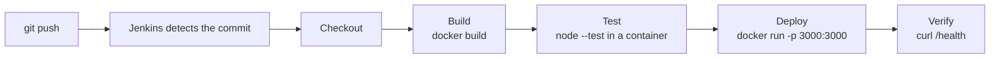

# Jenkins CI/CD Pipeline using Docker

## Project Overview

This project demonstrates a basic Continuous Integration and Continuous Deployment (CI/CD) pipeline using Jenkins and Docker.

The pipeline automates the process of checking out source code, building a Docker image, running automated tests, deploying the application in a Docker container, and verifying application health.

## Objective

To automate the build and deployment process of a Node.js application using Jenkins Pipeline and Docker.

## Tools and Technologies

- Jenkins
- Docker
- Node.js
- Git
- GitHub
- Linux / Ubuntu

## Pipeline overview



## Pipeline Stages

1. Checkout - Retrieves the latest source code from GitHub.
2. Build - Builds a Docker image for the application.
3. Test - Executes automated tests using Node.js.
4. Deploy - Runs the application inside a Docker container.
5. Verify - Checks the application health endpoint.

## Project Structure

```text
jenkins-cicd-pipeline/
│
├── docs/
│   ├── INTERVIEW_QA.md
│   └── screenshots/
│
├── test/
│   └── app.test.js
│
├── .dockerignore
├── .gitignore
├── Dockerfile
├── Jenkinsfile
├── package.json
├── package-lock.json
├── server.js
└── README.md
```

## Application Endpoints

| Endpoint | Purpose |
|---|---|
| `/` | Displays the application |
| `/health` | Checks application health |
| `/api/info` | Displays application information |

## How the Pipeline Works

1. Developer pushes code to GitHub.
2. Jenkins checks the repository for new commits.
3. Jenkins checks out the source code.
4. Docker builds the application image.
5. Automated tests run inside a Node.js container.
6. Jenkins deploys the application using Docker.
7. The health endpoint is checked to confirm deployment.

## Automatic Trigger

The Jenkinsfile uses SCM polling:

`H/2 * * * *`

Jenkins checks for new commits approximately every two minutes.

## Run Locally

Install dependencies:

```bash
npm install
```

Run tests:

```bash
npm test
```

Start application:

```bash
npm start
```

Open:

`http://localhost:3000`

## Run with Docker

Build the image:

```bash
docker build -t uday-task2-jenkins-app .
```

Run the container:

```bash
docker run -d -p 3000:3000 --name uday-task2-jenkins-app uday-task2-jenkins-app
```

Health check:

```bash
curl http://localhost:3000/health
```

## Jenkins Configuration

1. Install Jenkins on an Ubuntu/Linux machine.
2. Install the Pipeline and Git plugins.
3. Ensure Docker is installed and accessible to the Jenkins user.
4. Create a Pipeline job.
5. Select Pipeline script from SCM.
6. Select Git and provide the repository URL.
7. Select the main branch.
8. Set Script Path to `Jenkinsfile`.
9. Save and run the pipeline.

## Verification

After a successful pipeline execution:

- Check the Jenkins Stage View.
- Check the Console Output.
- Verify the Docker container using `docker ps`.
- Open the application on port 3000.
- Check the `/health` endpoint.

Screenshots of actual execution will be added in `docs/screenshots/`.

## Original Project Reference

This project uses the following public repository as its starting point:

https://github.com/Jafar19Khan/jenkins-cicd-pipeline

The project configuration and documentation have been adapted for this internship task.

## Conclusion

This project demonstrates how Jenkins and Docker can automate application build, testing, deployment, and health verification through a CI/CD pipeline.

